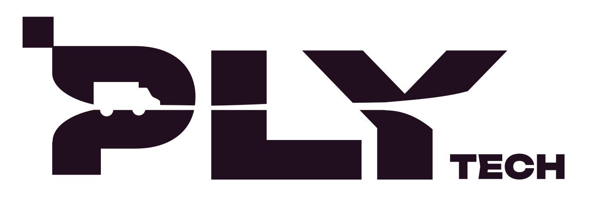
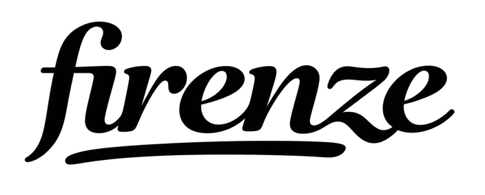
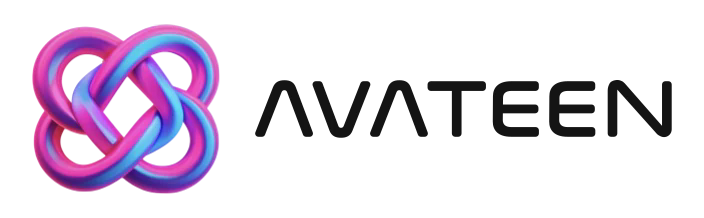

# Hi, I'm Fran 👋

I'm Francisco, a full stack developer from Lobos, Buenos Aires. I work at **Brace Developers**, building web apps with clients and a team.

Most days I work with TypeScript, React, Next.js, NestJS and PostgreSQL. I also take care of deployments and AWS infrastructure. I like talking to the people who use what we build: a conversation often changes what I thought the feature needed.

[Portfolio](https://www.frannpor-dev.com/) · [LinkedIn](https://www.linkedin.com/in/frannpor/) · [Email](mailto:porcielfranciscoramon@gmail.com)

## Some of my work

### 

A logistics platform that grew out of Llano Envíos. With Brace, I work on the frontend, backend and the tools people use to manage deliveries. Each organization has its own data and permissions.

### 

An online store and management system for an ice cream shop and café. I built the catalog, orders and branch tools, along with the backend and AWS infrastructure. There's also an Android app for printing receipts.

### 

A mental health support platform for teenagers, caregivers and psychologists. My work with Brace covers the interfaces, backend, role-based access and integrations.

## Outside work

I like games and music, and I tend to end up coding things around them. **GameVault** is a Windows game launcher I'm building and testing. **WePlay**, an idea for finding people to play with, is paused for now.

I've been learning more about infrastructure through the projects I work on: AWS CDK, Docker, GitHub Actions, permissions and monitoring. I use AI and agents while coding too, especially to investigate problems and compare approaches.

English: B2. If you'd like to work together, [send me a message](mailto:porcielfranciscoramon@gmail.com).

En español

## Hola, soy Fran 👋

Soy Francisco, de Lobos, Buenos Aires. Trabajo como full stack developer en **Brace Developers**, con clientes y un equipo.

Uso principalmente TypeScript, React, Next.js, NestJS y PostgreSQL. También me ocupo de despliegues e infraestructura en AWS. Me gusta hablar con quienes usan lo que construimos: muchas veces una charla cambia lo que pensaba que necesitaba una función.

### Algunos trabajos

- **[PLY](https://www.ply-tech.com/):** plataforma logística que nació de Llano Envíos. Trabajo con Brace en el frontend, el backend y las herramientas para gestionar envíos, con datos y permisos propios para cada organización.
- **[Firenze](https://heladeriafirenze.com/):** tienda y sistema de gestión para una heladería y cafetería. Desarrollé el catálogo, los pedidos y la operación por sucursal, el backend y la infraestructura en AWS. También una app Android para imprimir tickets.
- **Avateen:** plataforma de acompañamiento en salud mental para adolescentes, cuidadores y psicólogos. Trabajo con Brace en las interfaces, el backend, los accesos por rol y las integraciones.

Fuera del trabajo me gustan los juegos y la música, y suelo terminar programando algo alrededor de eso. Estoy construyendo y probando **GameVault**, un lanzador de juegos para Windows. **WePlay**, una idea para encontrar compañeros de juego, está en pausa.

Estoy aprendiendo más de infraestructura con los proyectos: AWS CDK, Docker, GitHub Actions, permisos y monitoreo. También uso IA y agentes al programar, sobre todo para investigar problemas y comparar alternativas.

Inglés B2. [Portfolio](https://www.frannpor-dev.com/) · [LinkedIn](https://www.linkedin.com/in/frannpor/) · [Escribime](mailto:porcielfranciscoramon@gmail.com)

