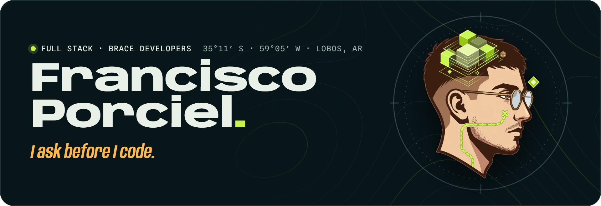
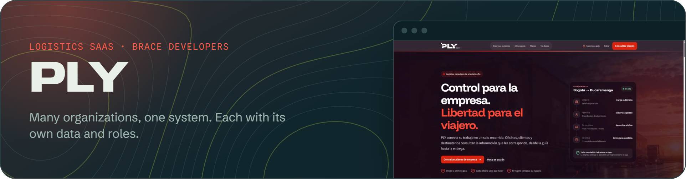
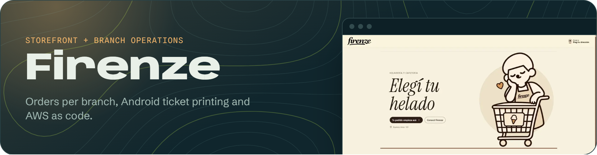
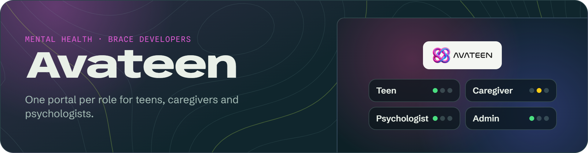
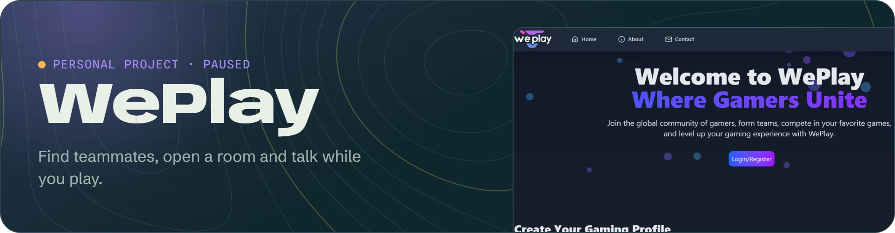

  <a href="https://www.frannpor-dev.com/"><b>Portfolio</b></a> &nbsp;·&nbsp;
  <a href="https://www.linkedin.com/in/frannpor/">LinkedIn</a> &nbsp;·&nbsp;
  <a href="mailto:porcielfranciscoramon@gmail.com">porcielfranciscoramon@gmail.com</a>

I build web products end to end at **Brace Developers**: interfaces, APIs, data and AWS infrastructure. Before writing code I like to understand how the business works and ask the questions nobody has asked yet.

## Work

## Stack

**Front** TypeScript · React · Next.js · Tailwind 
**Back** Node.js · NestJS · tRPC · PostgreSQL · Redis 
**Cloud** AWS CDK · ECS · RDS · S3 · SQS · Docker · GitHub Actions

AI is part of my workflow for research, alternatives and review. I set the scope and test what goes in.

Lobos, Buenos Aires · English B2 · Usually building something to play with friends.

En español

 

Desarrollo productos web de punta a punta en **Brace Developers**: interfaces, APIs, datos e infraestructura en AWS. Antes de programar me gusta entender cómo funciona el negocio y hacer las preguntas que todavía nadie hizo.

- **PLY:** SaaS logístico para varias organizaciones, cada una con sus datos y sus roles.
- **Firenze:** tienda y operación por sucursal para una heladería, con la infraestructura en AWS como código.
- **Avateen:** plataforma de salud mental con un portal por rol para adolescentes, cuidadores y psicólogos.
- **WePlay:** proyecto propio para encontrar compañeros y jugar. En pausa.

Uso IA para investigar, comparar alternativas y revisar. Defino el alcance y pruebo lo que entra.

[Portfolio](https://www.frannpor-dev.com/) · [LinkedIn](https://www.linkedin.com/in/frannpor/) · [Email](mailto:porcielfranciscoramon@gmail.com)

